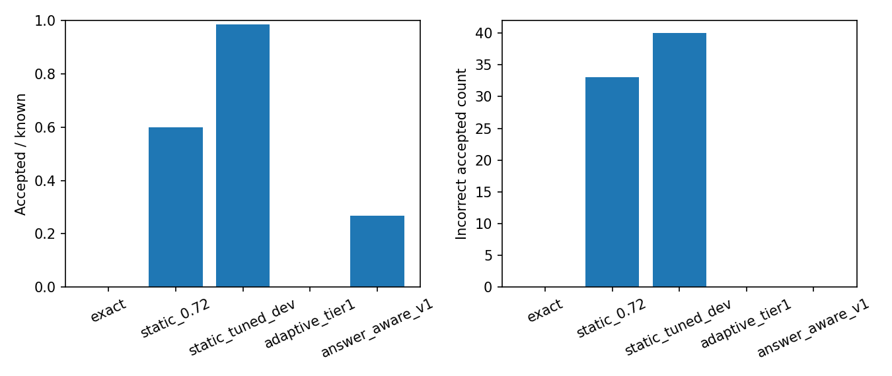

# Answer-aware cache: controlled local comparison

Run: `answer_aware_20261029_v6` · policy artifact: `4e3733ec95ca` · source revision at run: `9d41d1c7d7bf`.
The manifest hashes the controlled input, policy, decisions, metrics, and figure.
All 60 binary cases were authored for this study from 20 fact families; two
ambiguous cases were excluded from error-rate denominators. This is a
development benchmark, not an independent production sample.

| Policy | Accepted / 60 | Incorrect accepted | Incorrect / accepted | VERIFY / 62 | Warm decision p50 / p95 ms |
|---|---:|---:|---:|---:|---:|
| exact | 0 / 60 | 0 | undefined | 0 | 0.00 / 0.00 |
| static_0.72 | 36 / 60 | 33 | 91.7% | 0 | 0.01 / 0.01 |
| static_tuned_dev | 59 / 60 | 40 | 67.8% | 0 | 0.00 / 0.00 |
| adaptive_tier1 | 0 / 60 | 0 | undefined | 0 | 0.03 / 0.12 |
| answer_aware_v1 | 16 / 60 | 0 | 0.0% | 3 | 48.91 / 62.54 |

### Answer-aware results by case type

| Category | Cases | ACCEPT | VERIFY | Incorrect ACCEPT |
|---|---:|---:|---:|---:|
| valid_paraphrase | 20 | 16 | 1 | 0 |
| changed_fact | 20 | 0 | 0 | 0 |
| conflicting_answer | 20 | 0 | 0 | 0 |
| ambiguous | 2 | 0 | 2 | 0 |

The exact baseline has no candidate hit on these changed questions. The
historical static and adaptive policies use query-only decisions. A separate
static baseline was tuned on 15 earlier controls (threshold 0.27).
The new
policy checks the specific cached answer with a pinned NLI model and routes
uncertain candidates to the provider. REJECT also proceeds to the provider
in the gateway; it never returns the rejected cached answer. The two
ambiguous cases were not accepted by the answer-aware policy.

Model-load time was 35823 ms in this local run.
Latency is warm candidate-decision time only. It excludes embedding,
retrieval, network and provider generation. The `hash` embedding backend
is lexical and the 0.72 static threshold was historical, not retuned for
this controlled set. No cloud monetary saving or formal risk guarantee follows.

The policy has a 0.9 NLI acceptance threshold and a 0.2 rejection threshold
from its frozen artifact. These settings were chosen before the saved run,
but the cases and policy are both authored locally; independent transfer
validation is still needed. The earlier FLAN judge is excluded from
acceptance because it missed every positive validation case.
