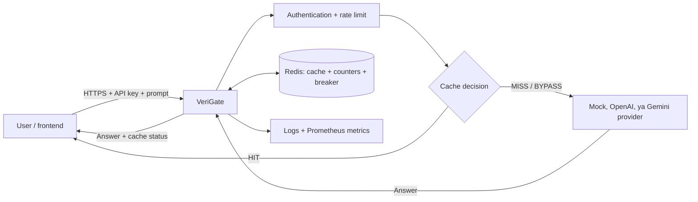
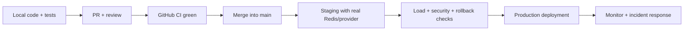

# VeriGate, zero se system samajhne tak

> **Aapka learning notebook · Beginner → builder → reviewer**
> Is guide ko pehle padhiye; phir [production audit report](../AUDIT_REPORT.md) padhiye. Yahaan goal commands yaad karna nahi, har request aur har design decision ka *reason* samajhna hai.

**Project ka ek-sentence version:** VeriGate ek **LLM gateway** hai. Aapki app ka question pehle VeriGate ke paas aata hai; VeriGate authentication, traffic control, cache decision, provider routing aur monitoring sambhal kar answer deta hai.

**Is guide ke baad aap explain kar paayenge:** request ka path, Redis mein kya rakha jaata hai, exact aur semantic caching ka farq, galat cache hit ka risk, real provider tak call kaise jaati hai, tests kya prove karte hain, aur code merge ke baad bhi deployment ke liye kya baaki rehta hai.

**Reference point:** 11 October 2026 ka current local source. Aage code/branch badle toh examples ko dobara verify kijiye.

| Level | Chapters | Aap kya samjhenge |
|---|---|---|
| 🌱 Foundations | [1](#chapter-1--hum-bana-kya-rahe-hain) · [2](#chapter-2--pehle-internetapi-ki-grammar) · [3](#chapter-3--stack-kaun-kyon-aur-kis-kaam-ke-liye) · [4](#chapter-4--project-ko-safely-chala-kar-dekhiye) | Product, API, technologies, local demo |
| 🛠️ System | [5](#chapter-5--ek-request-ki-poori-journey) · [6](#chapter-6--cache-exact-semantic-ttl-aur-lru) · [7](#chapter-7--semantic-math-ko-intuition-se-samajhiye) · [8](#chapter-8--provider-routing-failover-circuit-breaker-streaming) | Request flow, cache, math, provider |
| 🛡️ Engineering | [9](#chapter-9--security-reliability-aur-cost-teen-alag-axes) · [10](#chapter-10--monitoring-chal-raha-hai-ko-measure-kaise-karen) · [11](#chapter-11--pehle-kya-tha-se-ab-kya-hai-tak) · [12](#chapter-12--tests-kya-prove-karte-hain-kya-nahi) | Safety, signals, audit changes, evidence |
| 🚀 Ownership | [13](#chapter-13--docker-ci-merge-deploy-chaar-different-stages) · [14](#chapter-14--guided-code-reading-labs-vibe-coding-se-bahar) · [15](#chapter-15--mini-glossary-aur-aapki-self-check) | Release path, labs, self-check |

<details>
<summary><strong>Reading route: apni speed chuniye</strong></summary>

- **Bilkul beginner:** chapters 1–5 ko sequence mein padhiye; commands chapter 4 mein hain.
- **Code samajhna hai:** chapters 5–10 padhiye, aur diye gaye source links saath kholiye.
- **Review aur production:** chapters 11–15 padhiye; tab audit report zyada meaningful lagegi.
- Har chapter ke end ka **Khud socho** bina answer dekhe try kijiye. Agar answer explain nahi kar pa rahe, chapter ek baar phir padhiye.

</details>

---

## Chapter 1 — Hum bana kya rahe hain?

Sochiye ek company ka support chatbot hai. Roz 1,000 users poochte hain, “Password reset kaise karun?” Agar har baar paid LLM provider ko call jaaye, toh paise bhi lagenge aur wait bhi hoga. Ek **gateway** beech ka receptionist hai: request dekhta hai, rules lagata hai, aur zarurat ho tabhi provider ke paas bhejta hai.



**Teen problems** project ke center mein hain:

1. **Repeated work:** wahi question dobaara aaya toh answer reuse ho sakta hai.
2. **Wrong reuse:** “Austria ki capital?” ka answer “Australia ki capital?” ko dena silent bug hoga. Similar wording ka matlab same answer nahi hota.
3. **Changing answers:** “Aaj ka stock price?” ka kal wala answer aaj serve nahi hona chahiye.

Project proposal ka research aim **adaptive, self-verifying semantic cache** tha: related wording ko match karna, query ke hisaab se strictness badalna, candidate verify karna, aur time-sensitive prompts ko skip karna. Production audit ne ek key practical decision nikala: **current default `CACHE_MATCH_MODE=exact` hai**. Yaani same tenant ka bilkul same UTF-8 prompt hi default mein reuse hota hai. Semantic matching ab explicit opt-in experiment/feature hai, kyunki similarity aur equivalence identical concepts nahi hain. [Proposal](PROJECT_PROPOSAL.md) aur [current production configuration](PRODUCTION_CONFIGURATION.md) ko is historical context ke saath padhiye.

> **Teacher's test:** Agar user kahe “cache se cost bachegi, toh semantic hamesha on rakho,” aapka jawab hona chahiye: cost ke saath *wrong answer* ka risk bhi measure karna padta hai.

---

## Chapter 2 — Pehle internet/API ki grammar

**Client** request bhejta hai; **server** response deta hai. Browser ya mobile app client ho sakti hai. `POST /v1/chat` VeriGate ka ek **endpoint** hai. HTTP request ke teen important parts hain:

```http
POST /v1/chat HTTP/1.1
Content-Type: application/json
X-API-Key: demo-key-123

{"prompt":"Password reset kaise karun?"}
```

`POST` action hai, `/v1/chat` address hai, headers metadata hain, aur JSON body data hai. VeriGate ka response roughly aisa hota hai (answer/latency vary karenge):

```json
{
  "answer": "[mock:mock] Answer to: Password reset kaise karun?",
  "cache": "MISS",
  "provider": "mock",
  "latency_ms": 200.0,
  "threshold": null,
  "similarity": null,
  "note": "exact_match_required"
}
```

First request aam taur par `MISS`; identical next request `HIT` ho sakti hai. `BYPASS` ka matlab cache jaan-bujhkar skip hua, jaise “weather today?” (rule-based volatility detection). `threshold` aur `similarity` exact mode mein `null` reh sakte hain; unki zarurat semantic decision mein padti hai. [Response schema](../app/schemas.py) dekhiye.

| Status | Real-life matlab | Is project mein example |
|---|---|---|
| `200` | Request ka answer mila | HIT/MISS/BYPASS sab successful ho sakte hain |
| `400` / `422` | Input missing/invalid | Empty prompt; unsupported chat history |
| `401` | Identity prove nahi hui | Missing/wrong `X-API-Key` |
| `408` / `413` | Body der se aayi / bahut badi | Slow upload / request-size limit |
| `429` | Traffic ya daily admission limit | Rate limit/budget exceeded |
| `502` | Upstream provider failed | Provider unavailable/timeout |
| `503` | Gateway busy ya readiness failed | Concurrency cap / Redis failure |

**Synchronous vs asynchronous:** provider ya Redis ka wait CPU calculation nahi hota. Python `async`/`await` wait ke dauraan dusri requests ko progress karne deta hai. Lekin ML embedding inference CPU-heavy ho sakta hai; use background thread mein bhejna aur uski admission bound karna padta hai. [Gateway](../app/main.py), [limits](../app/limits.py) aur [cache inference gate](../app/cache/semantic_cache.py) mein dono patterns dikhte hain.

**Khud socho:** `200` response mein bhi `cache="BYPASS"` kaise possible hai? Kyunki BYPASS failure nahi; provider ne fresh answer diya.

---

## Chapter 3 — Stack: kaun, kyon, aur kis kaam ke liye?

“Stack” bas woh tools hain jo milkar product chalate hain. Har layer ko restaurant se compare kijiye: frontend order form, gateway counter, Redis quick-reference notebook, provider kitchen, aur metrics manager ki report.

| Layer / technology | VeriGate mein exact kaam | Kyon chuna / real-life analogy |
|---|---|---|
| **Python 3.11** | Application language | AI/ML ecosystem aur readable server code; restaurant ki common working language |
| **FastAPI + Starlette** | HTTP routes, middleware, streaming | Request ko correct handler tak pahunchana; reception counter |
| **Uvicorn (ASGI)** | Python app ko web server ki tarah run karna | Doors kholna; FastAPI khud listening server nahi |
| **Pydantic + pydantic-settings** | JSON validation, env config | Order form check: prompt valid hai? configuration typed hai? |
| **Redis / Redis Stack** | Shared cache, per-key rate counters, breaker state; optional vector index | Fast common notebook jo multiple workers dekh sakte hain |
| **fakeredis** | Local development/tests mein Redis-like in-memory state | Training notebook; **multi-machine production Redis nahi** |
| **NumPy** | Local vector matrix aur similarity calculation | Numerical calculator |
| **Sentence Transformers + MiniLM** | Prompt ko meaning-based vector banana | Similar meaning wale sentences ko near laane wala model; sirf semantic mode mein relevant |
| **PyTorch** | Transformer model ka inference runtime | ML engine; provider LLM ko train karne ka code nahi |
| **Optional NLI cross-encoder** | Candidate pair mein bidirectional entailment filter | “Kya dono questions ek doosre ko imply karte hain?” ka additional statistical test |
| **HTTPX** | OpenAI-compatible provider ko async HTTP calls | Kitchen ko external order bhejne wala courier |
| **HTML/CSS/JavaScript dashboard** | Same-origin `/ui` manual testing | Learning/debugging panel; full admin console ya React app nahi |
| **Prometheus + Grafana** | Numeric metrics scrape aur visualization | Manager ka operations dashboard |
| **pytest, Ruff, MyPy, pip-audit** | Behavior, style, type aur dependency checks | Quality gate ke alag inspectors |
| **Docker + Compose** | Gateway aur Redis ke reproducible containers | Packed kitchen aur notebook, consistent environment |
| **GitHub Actions CI** | PR/push par automated Linux checks | Reviewer se pehle machine-verification |

**Important difference:** `MiniLM` gateway ke *cache matching* ke liye hai. `OpenAI/Gemini` actual *answer generation* ke liye ho sakte hain. Embedding model ka output answer nahi, numbers ka vector hai. `hash` embedding backend deterministic lexical test helper hai; woh true semantic understanding nahi deta. [Embedder](../app/embeddings.py), [provider registry](../app/providers/registry.py).

**Config kis tarah aati hai?** Environment variables (jaise `CACHE_MATCH_MODE`, `REDIS_URL`) [Settings](../app/config.py) se parse hote hain. Running app startup par snapshot freeze karta hai; config badalne ke liye app restart/recreate kijiye. Default development mein mock provider, exact cache aur blank Redis URL (fakeredis) hai. **Mock answer knowledge answer nahi hai:** woh predictable placeholder hai, testing ke liye.

---

## Chapter 4 — Project ko safely chala kar dekhiye

Ye **Windows PowerShell local-learning** steps hain. Existing `.venv` ho toh naya banane ki zarurat nahi. Python 3.11 aur checked-in hash-locked dependencies reproducible path hain; full ML install bada ho sakta hai. Ek terminal mein:

```powershell
cd D:\miniProject\verigate
py -3.11 -m venv .venv
.\.venv\Scripts\python.exe -m pip install --require-hashes --extra-index-url https://download.pytorch.org/whl/cpu -r requirements.lock
.\.venv\Scripts\python.exe -m pip install --no-deps --no-build-isolation -e .
$env:ENVIRONMENT = "development"
$env:REDIS_URL = ""
$env:LLM_PROVIDER = "mock"
$env:CACHE_MATCH_MODE = "exact"
.\.venv\Scripts\python.exe -m uvicorn app.main:app --reload
```

`--reload` development convenience hai. Is exact-mode demo mein MiniLM inference nahi chalti. Browser mein `http://127.0.0.1:8000/ui` ya `/docs` kholiye. Dusre PowerShell terminal mein:

```powershell
$headers = @{ "X-API-Key" = "demo-key-123" }
$body = '{"prompt":"Password reset kaise karun?"}'
Invoke-RestMethod -Uri "http://127.0.0.1:8000/v1/chat" -Method Post -Headers $headers -ContentType "application/json" -Body $body
Invoke-RestMethod -Uri "http://127.0.0.1:8000/v1/chat" -Method Post -Headers $headers -ContentType "application/json" -Body $body
```

Expected observation: pehli request `MISS`, dusri `HIT`, `provider` dusri baar `cache`. Agar purani `.env` file overrides deti hai, actual mode `/ready` se check kijiye. `demo-key-123` aur `mock` **sirf development** ke liye hain. Paid API key dalne ki is exercise mein zarurat nahi.

> **Experiment:** Body mein `"prompt":"Weather today?"` try kijiye. Code ka keyword filter isko `BYPASS` karega. Keyword list perfect freshness classifier nahi; “present chief executive” jaisi time-sensitive wording miss ho sakti hai. [Volatility rules](../app/cache/volatility.py) kholiye.

---

## Chapter 5 — Ek request ki poori journey

Ab [main.py](../app/main.py) mein `chat()` function ko finger se trace kijiye:

```text
HTTP body limits → Pydantic input check → API-key auth → rate limit
  → tenant ID → empty-prompt check → cache lookup
      ├─ HIT: cached answer, no provider call, no daily admission charge
      └─ MISS/BYPASS: daily admission check → provider route + answer
           ├─ MISS: answer cache mein store (agar size/policy allow kare)
           └─ BYPASS: answer return, store mat karo
  → counters/latency → JSON response
```

**Middleware** route se pehle/baad common kaam karta hai: request body size, timeout, concurrency, structured log context. **Pydantic** `prompt` ya exactly *one* `{role:"user",content:"..."}` message accept karta hai. Multi-turn history/system messages abhi supported nahi; silently drop karne ki jagah `422` reject hota hai. Ye security/correctness choice hai: “Ignore previous instruction” jaise missing context ke saath cached answer dena dangerous hota. [Schemas](../app/schemas.py) dekhiye.

**Tenant isolation:** API key se [HMAC-SHA256](../app/identity.py) ke through opaque tenant ID banta hai. Company A aur B ka identical prompt bhi ek doosre ki cache entry nahi padhta. Raw API key ko Redis key/log mein rakhna avoid hota hai. Salt stable rakhiye; badalne par identities/cache namespace effectively change ho sakte hain. Ye encryption nahi, keyed identity derivation hai.

**Reasoning exercise:** `HIT` aur `MISS` dono pe rate limit kyon? Rate limiter gateway ko overload se bachata hai; budget paid-provider admissions ko track karta hai. Dono alag controls hain.

---

## Chapter 6 — Cache: exact, semantic, TTL aur LRU

**Cache** ek reusable answer ka store hai. Key question: *kab reuse safe hai?*

| Mode | Decision | Speed / risk | Kab use karein |
|---|---|---|---|
| `exact` (**default**) | Same tenant, same namespace, identical UTF-8 prompt | Fast; no embedding inference; paraphrase miss karega | Safer starting point |
| `semantic` (opt-in) | Nearest vector candidate + threshold + verifier | Paraphrases hit kar sakte hain; false-hit risk rehta hai | Domain-specific evaluation ke baad |

Exact mode mein prompt ka SHA-256 entry ID banta hai; Redis entry se actual `query` bhi compare hoti hai. “password reset” aur “Password reset” alag bytes hain; default mein equivalent nahi. Exact reuse bhi **truth guarantee nahi**: original provider answer galat ho sakta hai ya duniya badal sakti hai.

**Redis source of truth** hai. In-process NumPy index semantic search ko speed deta hai, lekin shared Redis writes/clears ke baad version check se reload hota hai. Candidate return karne se pehle live Redis entry confirm hoti hai. Multi-worker semantic search ke liye Redis Stack ka RediSearch HNSW index alternate backend hai; tenant tag filter cross-tenant match rokta hai. [Semantic cache](../app/cache/semantic_cache.py), [storage](../app/cache/storage.py), [RediSearch store](../app/cache/redisearch_store.py).

| Redis structure | Kya rakhta hai | Analogy |
|---|---|---|
| Entry hash | prompt, answer, optional vector | Library card |
| IDs set | tenant ki entries ke IDs | Catalogue |
| LRU sorted set | last-use order | Purani magazines ka stack |
| Version marker | kisi worker ko index rebuild signal | “Catalogue updated” stamp |

**TTL** entry ka time-to-live hai: default 3,600 seconds. **LRU** least-recently-used eviction hai: tenant ki default 256-entry bound ke baad purani entry nikalti hai. `WATCH`-based Redis transaction write/eviction ko concurrent requests ke beech consistent rakhne ke liye hai. Cache entry bytes bhi bounded hain. Namespace mein model/provider/policy/epoch ka digest hota hai: model badalne par purane answers accidentally naye setup mein reuse na hon. Ye model/answer ko magically validate nahi karta; configuration-specific cache separation deta hai. [Namespace](../app/cache/namespace.py).

**Khud socho:** TTL 1 hour hai, toh “weather today” ko 1 hour cache karna safe hoga? Zaroori nahi—weather aur price minute-to-minute badal sakte hain. Isliye volatility rule cache ko bypass karta hai; rule coverage ko real domain data se test karna hoga.

---

## Chapter 7 — Semantic math ko intuition se samajhiye

Semantic mode mein `MiniLM` text ko **384 numbers ke vector** mein convert karta hai. Simple visual model: topics/meaning ko high-dimensional map mein points samajhiye. Similar questions ke points nazdeek aa sakte hain. Normalized vectors ka **dot product ≈ cosine similarity**:

```text
similarity(q, cached) = normalized_vector(q) · normalized_vector(cached)
0.91 ≥ threshold 0.82  → candidate consider karo
0.74 < threshold 0.82  → MISS
```

**Candidate consider** final HIT nahi hota. [Policy](../app/cache/policy.py) pehle threshold check karta hai, phir [verifier](../app/cache/verifier.py). [Adaptive threshold](../app/cache/threshold.py) base `0.72` se start karta hai; numbers, capitalized-name proxy, short prompt, aur crowded vector neighbourhood se strictness badhata hai; result `0.70–0.98` mein clamp hota hai. Static baseline `0.72` alag evaluation case hai. Ye hand-written heuristic hai, trained proof of correctness nahi.

**Tier-1 verifier** number sets, negation presence aur capitalization-based entity sets compare karta hai. Example: “Order **12** cancel karo” vs “Order **21** cancel karo” reject. “Can I reset?” vs “Can I **not** reset?” reject. Lekin “Alice paid Bob” vs “Bob paid Alice” ke numbers/entities same ho sakte hain—role reversal Tier-1 miss kar sakta hai. “Reset password” vs “reset router” bhi near ho sakte hain. Isliye semantic opt-in ka risk real hai.

**Tier-2 NLI** optional hai (`VERIFIER_NLI=false` default). Pair ko *dono directions* mein entailment check karta hai. Model unavailable ho toh semantic reuse reject hota hai. NLI bhi statistical model hai, guarantee nahi. False HIT ka practical impact samajhiye: wrong cached answer confident-looking hota hai aur provider ko call bhi nahi jaati, isliye bug silently repeat ho sakta hai.

> **Small benchmark, limited conclusion:** Recorded local evaluation mein Tier-1 ne 15 positive pairs mein 5 hits aur 15 negative pairs mein 0 observed hits diye; NLI ne 15 positive pairs mein 3 hits aur 15 negative pairs mein 0 observed hits diye. “0/15” ka matlab universal zero false hits nahi. Dataset expand, domain-specific edge cases aur confidence intervals chahiye. [Audit evidence](../AUDIT_REPORT.md), [evaluation harness](../evaluation/run.py).

---

## Chapter 8 — Provider routing, failover, circuit breaker, streaming

`MISS/BYPASS` par [ProviderRegistry](../app/providers/registry.py) configured provider choose karta hai. Default `mock` deterministic placeholder answer deta hai; real mode OpenAI ya Gemini OpenAI-compatible endpoint ko [HTTPX client](../app/providers/openai_compat.py) se call karta hai. **Real provider failure par mock answer silently substitute nahi hota.** Isse test output ko real answer samajhne ki galti nahi hoti.

Optional **cascade** simple question ko cheaper model aur complex question ko stronger model bhejne ka heuristic hai. Ye default off hai. “Compare X and Y” jaise signals complexity score badhate hain. Provider list mein available configured tiers failover ke liye use ho sakte hain; retries/attempts monetary cost ko badha sakte hain.

**Circuit breaker** bijli ke fuse jaisa hai. Transient failures baar-baar ho rahe hain toh provider ko cooldown tak skip karo; phir ek controlled probe allow karo. State Redis mein shared hai. Late success ko newer failure state erase nahi karne dene ke liye generation/probe ownership check hai. Har HTTP 4xx ko transient failure nahi maana jaata. [Breaker](../app/providers/breaker.py).

**Streaming** mein answer tukdon mein **Server-Sent Events (SSE)** ke through aata hai: `data: "..."`, phir `data: [DONE]`. Client ko full answer wait nahi karna padta. `/v1/chat/stream` cache hit ko bhi event format mein bhejta hai. Miss stream complete hone par hi assembled answer cache ho sakta hai; upstream stream tootne par `event: error` milta hai. `POST /v1/chat` simpler JSON version hai. [Both endpoints](../app/main.py).

**Khud socho:** Agar stream aadha answer dekar fail ho, use cache mein kyon nahi rakhna? Agla user incomplete answer ko full answer samajh lega.

---

## Chapter 9 — Security, reliability aur cost: teen alag axes

**Security** ka question: kaun kya dekh sakta hai? **Reliability:** failure par kya hota hai? **Cost control:** kitne expensive provider calls allowed hain? Ek control teenon solve nahi karta.

| Control | Practical purpose | Boundary / limitation |
|---|---|---|
| API key + HMAC tenant ID | Authorized callers, separate caches | Key leak ho toh rotate karna padega |
| Redis token-bucket rate limit | Bursts roko; default capacity 20, refill 5/sec | Ye monetary cap nahi; HIT bhi token use karta hai |
| Daily admitted-request budget | Per API key/UTC day `MISS/BYPASS` count | Default `0` = disabled; retries, tokens, rupees/dollars **count nahi** karta |
| Size/time/concurrency limits | Excess traffic/body/response resource bounds | 64 concurrent **per worker**; whole distributed system cap nahi |
| Separate metrics token | `/metrics` ko tenant API key se alag protect karta hai | Public exposure/network policy deployment par set karni hogi |
| Production config validation | Demo key/mock/blank Redis/short salt se startup roke | TLS, provider spend caps, alerting khud setup karne padenge |
| TTL + bounded entries | Cache memory/retention limit | PII policy ya encryption ka substitute nahi |

**Token bucket example:** capacity 5, refill 1 token/sec. Agar 6 calls ek hi instant par aayen, first 5 pass, sixth `429`; 1 second baad ~1 token refill, phir ek call pass. Real default values alag hain. [Rate limiter](../app/rate_limit.py) real Redis mein atomic Lua script, fakeredis mein WATCH transaction use karta hai.

**Daily budget example:** budget 2 set kiya. A ka first `MISS` count 1, same exact A `HIT` count 1 hi, B `MISS` count 2, C `MISS` par `429`. Provider retry/cascade attempts ek admission mein multiple paid upstream calls bana sakte hain; **provider-side spend limit alag lagani hi hogi**. [Budget](../app/budget.py).

Production validation [config.py](../app/config.py) mein checks lagata hai: shared Redis, non-demo API keys, private metrics token, 32+ character salt, explicit CORS (wildcard disallowed), real provider. Redis ko finite maxmemory chahiye. TLS/HTTPS, secret storage/rotation, Redis access control, provider account billing caps, backup/retention aur load test application code se complete nahi ho jaate. [Production configuration](PRODUCTION_CONFIGURATION.md).

---

## Chapter 10 — Monitoring: “chal raha hai” ko measure kaise karen?

**Logs** ek request ki story dete hain; **metrics** hazaar requests ka trend. Example: `cache_hit` log batata hai ek request HIT thi; Prometheus counter batata hai kitni HITs hui. [metrics.py](../app/metrics.py) counters/histograms define karta hai. [Dashboard](../app/static/dashboard.html) manual testing UI hai; [Prometheus/Grafana Compose](../docker-compose.observability.yml) operations graphs ke liye hai.

| Signal | Sawal |
|---|---|
| Hit rate = HIT / (HIT + MISS + BYPASS) | Cache kitna kaam save kar raha hai? |
| Verifier rejects | Kitne candidates similarity pass karke structural/NLI filter par ruke? |
| p50 / p95 / p99 latency | Typical, slow, very slow requests kitne time lete hain? |
| Rate-limited / budget-exceeded | Policy user ko kitni baar rok rahi hai? |
| Provider errors / stream errors | Upstream ya network reliability kaisi hai? |

`/live` process alive check hai. `/ready` (alias `/health`) Redis ping karta hai, aur semantic RediSearch mode mein index schema verify karta hai. **Provider health field sirf configuration-only hai**; koi paid probe nahi hota. Isliye green readiness ka matlab provider response guaranteed nahi. `/metrics` private token se protected hai. [Routes](../app/main.py).

**Khud socho:** 95% hit rate achhi lagti hai. Agar usme 1% wrong HIT ho, high-stakes support mein kya hoga? Accuracy/false-hit rate aur latency ko saath dekhna zaroori hai.

---

## Chapter 11 — “Pehle kya tha?” se “ab kya hai?” tak

Project **audit se pehle already bana hua tha**: gateway, semantic research idea, FastAPI endpoints, Redis/fakeredis, embeddings, verifier, provider integrations, demos, evaluation aur documentation maujood the. Audit ne *poora product zero se nahi banaya*. Usne existing behavior ko adversarially check kiya, specific defects reproduce kiye, aur release-oriented hardening ki. [Proposal](PROJECT_PROPOSAL.md) intent batata hai; [audit report](../AUDIT_REPORT.md) evidence/changes batata hai.

| Area | Audit se pehle problem/assumption | Ab code mein kya badla, aur kyon |
|---|---|---|
| Semantic cache | Approximate match ko default safe maan lena galat answer reuse kar sakta tha | Exact default; semantic opt-in; role-reversal regression. Correctness ko cost saving se pehle rakha |
| Cache identity | Model/provider/policy badalne par old answer/vector mix ho sakte the | Versioned namespace + Redis Stack schema validation |
| Tenant/security | Secret-derived data keys/logging aur isolation risk | HMAC opaque IDs; tenant-scoped reads/writes; safer logging |
| Budget | “Spend cap” wording paise ki guarantee imply karta tha | “Daily admitted misses/bypasses” ka exact meaning; provider spend controls alag |
| Resource limits | Body, concurrent streams, answer/cache size ka unbounded risk | Body deadline/size, response concurrency/size, cache TTL/LRU/tenant bound, inference gate |
| Settings/lifecycle | Mutable global settings aur shared resources conflicting apps mein mix ho sakte the | Startup-frozen app snapshot, app-owned Redis/model/client resources, proper cleanup |
| Circuit breaker | Concurrent late results nayi failure state ko galat reset kar sakte the | Generation checks + owned half-open probe |
| Observability | Worker metrics, streaming errors, readiness ki gaps | Multiprocess metrics, stream completion/error counts, `/live` vs `/ready` |
| Build/reproducibility | Floating dependencies/model/container versions se same code alag behavior de sakta tha | Hashed dependency locks, pinned model revisions, image digests, Linux CI/Redis tests |
| Dashboard | Failed API operation successful dikh sakti thi | Error handling aur bounded displayed history |

**Git history ka separate issue:** VeriGate ka `.git` metadata missing hua tha. Verified GitHub origin se separate VeriGate Git checkout restore kiya gaya; parent Drecovery repo ko substitute nahi kiya. Remediation branch/PR par code review/CI hua; earlier discussion ke mutabik PR #1 main mein merge hua. **Merge source-code event hai; live deployment proof nahi.** Current working folder mein uncommitted/modified files ho sakte hain, isliye is guide mein “current local code” aur “GitHub main” ko automatically identical mat samajhiye. Kisi production step se pehle exact commit, clean checkout aur CI result dobara verify karenge.

> **Audit report reading tip:** Uske neeche original “FAIL/open findings” sections historical snapshot hain; top “Remediation update” later fixes batata hai. Report mein kuch CI/merge statements likhne ke waqt ki state par hain. Date/commit ke context mein padhiye, permanent current status ki tarah nahi.

---

## Chapter 12 — Tests kya prove karte hain, kya nahi?

`pytest` behavior examples run karta hai: auth, cache HIT/MISS, tenant isolation, time-sensitive BYPASS, rate limit, streaming, breaker, config and regressions. Unit tests fakeredis/mock se fast hote hain. Live Redis Stack tests real Lua/RediSearch/cross-process behavior check karte hain. Evaluation labelled positive/negative pairs par cache decision measure karti hai. [Tests](../tests), [CI workflow](../.github/workflows/ci.yml), [evaluation](../evaluation/run.py).

**Confusion matrix sochiye:**

| Reality ↓ / cache decision → | HIT | MISS |
|---|---|---|
| Questions equivalent hain | Useful hit (cost saved) | Safe but costlier miss |
| Questions different hain | **False hit: wrong reuse** | Correct miss |

Research trade-off: threshold loose karoge toh more hits, potentially more false hits; strict karoge toh fewer false hits, but fewer savings. Negative test dataset jitna realistic, conclusion utna useful. 15 negatives mein zero false hits *proof* nahi; future prompts new failure modes la sakte hain. Caching correctness ko generation correctness se alag measure kijiye: provider khud wrong answer de sakta hai.

**CI ke gates:** lint/format/MyPy, standard tests+evaluation, Redis Stack integration, dependency scan, Docker build/health smoke; main par deploy-check in jobs ko depend karta hai. Recent audit continuation mein clean Python 3.11 suite (50 tests locally, four live Redis tests separately), Redis Stack CI (54 tests), Docker build aur security checks pass hue the. Ye strong evidence hai, **specific revision ke liye**. CI pass ka matlab public deployment, real provider, TLS, backups, production traffic aur latency SLO validated nahi.

**Aap khud run karein:**

```powershell
.\.venv\Scripts\python.exe -m pytest tests -q
.\.venv\Scripts\python.exe -m ruff check .
.\.venv\Scripts\python.exe -m mypy app
```

Local environment difference se failure aaye toh error ka type dekhiye—test assertion, missing dependency, Redis unavailable, ya Python version. “Test fail” ko bina diagnosis code bug ya environment bug declare na kijiye.

---

## Chapter 13 — Docker, CI, merge, deploy: chaar different stages



**Docker image** app + runtime dependencies ko package karta hai. [Dockerfile](../Dockerfile) Python 3.11 base digest pin karta hai, hashed runtime lock install karta hai, non-root user se Uvicorn run karta hai, healthcheck lagata hai. [Compose](../docker-compose.yml) local gateway + Redis Stack saath chalata hai; Redis local loopback ports par hai. Compose ka default provider `mock` hai—working demo, paid-production integration nahi.

**GitHub Actions CI** check karta hai ki commit Linux/Python 3.11 par build/test ho. **Merge** reviewed code ko main branch mein laata hai. **Deploy** app ko real environment mein secrets, public HTTPS, data store, operations ke saath chalata hai. In chaaron ko ek word “done” mein mix mat kijiye.

**Actual production se pehle hum saath verify karenge:** exact desired GitHub commit/main branch; live environment secrets and least access; real shared Redis (auth, maxmemory, backup/retention); provider credential and provider-side spend limit; TLS/domain/CORS; intended load aur p95/p99 target; monitoring/alerts; rollback plan; smoke test. [Production configuration](PRODUCTION_CONFIGURATION.md) technical requirements deta hai. Is guide ko padhne ke liye ye steps abhi execute karne ki zarurat nahi.

---

## Chapter 14 — Guided code-reading labs: “vibe coding” se bahar

Har lab ka rule: pehle **prediction** likhiye, phir source kholiye, phir local run/test se verify kijiye. Agar output surprising ho, us line tak call stack trace kijiye.

1. **Route map:** [main.py](../app/main.py) mein `/v1/chat` dhoondhiye. `req.as_prompt()` se response return tak branches draw kijiye. HIT par provider ko call hoti hai? Budget count hota hai?
2. **Validation:** [schemas.py](../app/schemas.py) mein `messages` list constraints dhoondhiye. Do user messages bhejne par 422 kyon? Ek empty `prompt` par 400 kyon?
3. **Exact cache:** [semantic_cache.py](../app/cache/semantic_cache.py) mein `cache_match_mode == "exact"` branch padhiye. `SHA256` ID ke bawajood row ki `query` compare kyon hoti hai?
4. **Volatility:** [volatility.py](../app/cache/volatility.py) mein keyword list dekhiye. Aise teen time-sensitive queries likhiye jo rules miss kar sakte hain. Ye future benchmark cases hain.
5. **Semantic pitfall:** [verifier.py](../app/cache/verifier.py) mein `_numbers`, `_negation_flag`, `_entities` dekhiye. “Alice paid Bob” vs “Bob paid Alice” par sets kya honge? Ek stronger test ka idea likhiye.
6. **Concurrency:** [storage.py](../app/cache/storage.py) mein `WATCH`/`MULTI` flow dekhiye. Do workers same tenant mein write karen toh retry kyon hota hai?
7. **Rate vs budget:** [rate_limit.py](../app/rate_limit.py) aur [budget.py](../app/budget.py) compare kijiye. Kaunsa HIT par charge karega? Kaunsa UTC day reset hoga?
8. **Provider failure:** [registry.py](../app/providers/registry.py) aur [breaker.py](../app/providers/breaker.py) trace kijiye. Agar selected real provider fail ho aur koi configured fallback na ho, response kya hoga? Mock kyon nahi?
9. **Release evidence:** [CI workflow](../.github/workflows/ci.yml) mein jobs padhiye. Kya workflow deployment karta hai, ya sirf deploy-check? Difference ek paragraph mein likhiye.

<details>
<summary><strong>Labs 1, 2, 7, 8, 9 ke short answers (pehle khud try karein)</strong></summary>

1. HIT branch cached answer return karti hai; provider aur daily admission budget skip hote hain. Rate limit usse pehle chalti hai.
2. API deliberately single-turn hai; unsupported history reject hoti hai. Empty prompt route mein 400.
7. Rate limiter every authenticated chat request; daily budget only MISS/BYPASS; budget key UTC day ka hai.
8. Configured failover exhausted ho toh upstream unavailable (`502`); real requests ko fake mock answer nahi milta.
9. `deploy-check` all required CI jobs ke pass hone ka gate hai; real deployment command nahi.

</details>

---

## Chapter 15 — Mini glossary aur aapki self-check

| Term | Simple meaning |
|---|---|
| **Gateway** | Client aur provider ke beech policy layer |
| **Provider** | Answer generate karne wala upstream service/model |
| **Endpoint** | HTTP method + URL par available action |
| **Middleware** | Many routes par common pre/post-processing |
| **Tenant** | Ek isolated customer/API-key identity |
| **Cache HIT / MISS / BYPASS** | Reused / not found / intentionally skipped |
| **TTL / LRU** | Time ke baad expire / least-recently-used eviction |
| **Embedding** | Text ka numeric meaning representation |
| **Cosine similarity** | Vectors ke beech closeness score |
| **Threshold** | Minimum score jiske baad candidate consider ho |
| **False hit** | Different question par wrong cached answer reuse |
| **NLI** | Natural Language Inference; entailment estimate |
| **HNSW / KNN** | Approximate fast vector index / nearest-neighbour search |
| **HMAC** | Secret salt/key ke saath stable opaque digest |
| **Token bucket** | Burst + refill-based request limiter |
| **Circuit breaker** | Failing provider ko temporarily skip karna |
| **SSE** | HTTP par incremental server-to-client events |
| **CI** | Commit par automated quality checks |
| **SLO / p95** | Service target / 95% requests is latency ke andar |
| **Rollback** | Bad release ko previous known-good version par lautana |

**Aapki viva checklist — in 10 questions ka jawab bina guide dekhe bol paate hain?**

1. VeriGate frontend aur LLM provider ke beech kyon hai?
2. `MISS` aur `BYPASS` mein kya farq hai?
3. Exact mode safer kyon hai, aur uski limitation kya hai?
4. “Similar” question ka “same answer” hona guaranteed kyon nahi?
5. Redis source of truth hai toh in-process NumPy index kyon?
6. Tenant isolation ka code-level mechanism kya hai?
7. Rate limit aur daily admission budget ka difference kya hai?
8. `200 HIT` ke bawajood answer incorrect kaise ho sakta hai?
9. Green CI aur production-ready deployment mein kya gap hai?
10. Audit report ke original FAIL section aur later remediation update ko saath kaise padhoge?

**Next reading order:** is guide ke labs → [current architecture](ARCHITECTURE_PRODUCTION.md) → [production configuration](PRODUCTION_CONFIGURATION.md) → [audit report](../AUDIT_REPORT.md). Audit par aap ek-ek finding ko source, test aur remaining deployment requirement se map kar paayenge. Uske baad hum exact main revision se step-by-step staging aur production plan banayenge.

> **Final habit:** Har change ke liye teen sawaal likhiye—“Behavior kya badla?”, “Evidence kya hai?”, “Kaunsi limitation abhi bhi hai?” Yehi engineering understanding hai.
